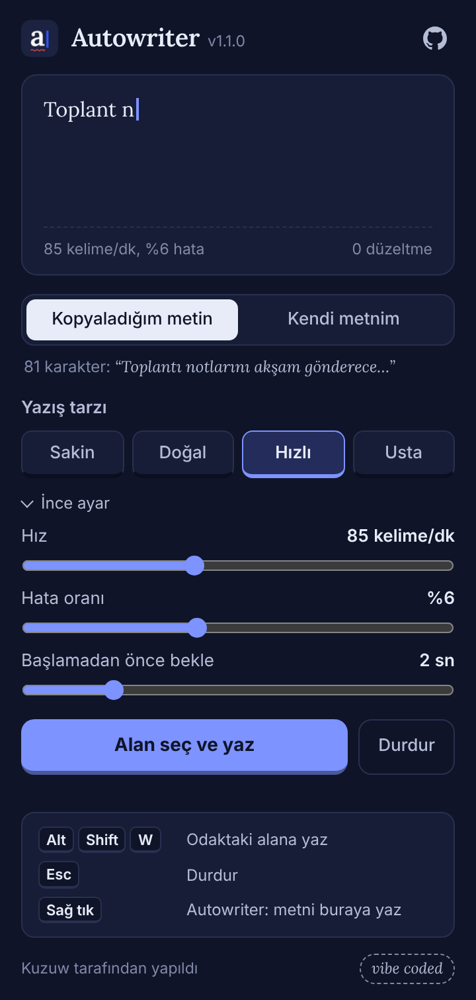

<p align="center">
  
</p>

<p align="center">
  <a href="https://github.com/Kuzuw/autowriter/actions/workflows/ci.yml"></a>
  
  
  <a href="LICENSE"></a>
  
  <a href="https://github.com/Kuzuw"></a>
</p>

<p align="center">
  <b>Metni kopyala, alana tıkla, gerisini Autowriter'a bırak.</b><br>
  Harf harf, değişken hızla yazar. Arada yanlış tuşa basar, fark eder, silip düzeltir.
</p>

<p align="center">
  
</p>

---

## İçindekiler

- [Özellikler](#özellikler)
- [Kurulum](#kurulum)
- [Kullanım](#kullanım)
- [Ayarlar](#ayarlar)
- [Nasıl çalışır?](#nasıl-çalışır)
- [Gizlilik](#gizlilik)
- [Geliştirme](#geliştirme)
- [Vibe coded](#vibe-coded)
- [Lisans](#lisans)

## Özellikler

- **İnsan gibi ritim:** Her tuş arası farklı. Boşlukta, virgülde ve nokta sonrasında duraksar, ara sıra "düşünür". Hız da yazdıkça hafifçe dalgalanır.
- **Gerçekçi yazım hataları:** Türkçe Q klavyede yanındaki tuşa basma, harfi iki kez yazma, iki harfin yerini karıştırma ve harf atlama. Hatayı hemen ya da birkaç harf sonra fark eder, siler, doğrusunu yazar.
- **Her alanda çalışır:** `input`, `textarea` ve `contenteditable` editörler. iframe ve Shadow DOM içindeki alanlar dahil.
- **Üç başlatma yolu:** Popup'tan alan seçme, `Alt+Shift+W` kısayolu ve sağ tık menüsü.
- **Canlı önizleme:** Popup, seçtiğin ayarlarla nasıl yazacağını önceden gösterir.
- **Hazır yazış tarzları:** Sakin, Doğal, Hızlı, Usta. İstersen hız ve hata oranını kendin ayarla.
- **Her an durdurulabilir:** `Esc` tuşu ya da ekrandaki **Durdur** düğmesi.
- **Açık ve koyu tema:** Sistem temanı izler.
- **Gizlilik dostu:** Ağ isteği yok, veri toplama yok. Şifre alanlarına yazmaz.

## Kurulum

### GitHub Release'ten (önerilen)

1. [Releases](https://github.com/Kuzuw/autowriter/releases) sayfasından son `autowriter-x.y.z.zip` dosyasını indir ve bir klasöre çıkar.
2. Chrome'da `chrome://extensions` adresini aç.
3. Sağ üstten **Geliştirici modu**'nu aç.
4. **Paketlenmemiş öğe yükle**'ye tıkla ve çıkardığın klasörü seç.

### Kaynaktan

```bash
git clone https://github.com/Kuzuw/autowriter
```

Sonra yukarıdaki 2-4. adımlarla `autowriter` klasörünü yükle.

> Edge (`edge://extensions`), Brave (`brave://extensions`) ve diğer Chromium tabanlı tarayıcılarda da aynı adımlarla çalışır.

## Kullanım

| Yol | Nasıl |
| --- | --- |
| **Popup** | Metni kopyala, eklenti ikonuna tıkla, **Alan seç ve yaz**'a bas, yazılacak kutuya tıkla. |
| **Kısayol** | Metni kopyala, yazı alanına tıkla, `Alt+Shift+W` tuşlarına bas. Yazarken tekrar basarsan durur. |
| **Sağ tık** | Yazı alanına sağ tıkla, **Autowriter: metni buraya yaz**'ı seç. |

Kısayolu `chrome://extensions/shortcuts` adresinden değiştirebilirsin.

<table>
  <tr>
    <td align="center"><br><sub>Popup, açık tema</sub></td>
    <td align="center"><br><sub>Koyu tema ve ince ayar</sub></td>
  </tr>
  <tr>
    <td align="center"><br><sub>Yazılacak alanı seçme</sub></td>
    <td align="center"><br><sub>Bitince karakter ve düzeltme sayısı</sub></td>
  </tr>
</table>

## Ayarlar

| Yazış tarzı | Hız | Hata oranı | Kimin gibi |
| --- | --- | --- | --- |
| Sakin | 35 kelime/dk | %2 | Düşünerek yazan biri |
| Doğal | 55 kelime/dk | %4 | Ortalama bir kullanıcı (varsayılan) |
| Hızlı | 85 kelime/dk | %6 | Hızlı ama özensiz |
| Usta | 125 kelime/dk | %2 | On parmak yazan biri |

**İnce ayar** bölümünden:

- **Hız:** 10–200 kelime/dk
- **Hata oranı:** %0–15. Sıfır yaparsan hiç hata yapmaz.
- **Başlamadan önce bekle:** 0–10 saniye. Pencere değiştirmek ya da imleci yerleştirmek için zaman tanır.
- **Metin kaynağı:** Kopyaladığın metin ya da popup'a yapıştırdığın kendi metnin.

## Nasıl çalışır?

Yazma mantığı DOM'dan bağımsız tek bir modülde, [`engine.js`](engine.js) içinde:

1. Hedef hız, karakter başına ortalama bir süreye çevrilir (`60000 / (kelime/dk × 5)` ms).
2. Her tuş bu sürenin 0,55 ile 1,6 katı arasında rastgele bekler. Her 15 tuşta bir genel ritim biraz hızlanır ya da yavaşlar.
3. Boşluk, noktalama ve satır sonlarına ek duraklama eklenir; nadiren 0,5–1,6 sn'lik "düşünme" molası verilir.
4. Bir harf hata oranına göre seçilirse dört hata türünden biri uygulanır. Yanlış harften sonra 0–3 doğru harf daha yazılır, kısa bir duraksamadan sonra hepsi silinip doğrusu yazılır.

Motor her durumda kaynak metnin birebir aynısını üretir. Bu, 300 farklı rastgele tohum ve Türkçe karakterli metinlerle [`test/engine.test.js`](test/engine.test.js) içinde sınanır.

Sayfa tarafında ([`content.js`](content.js)) her karakter, sitelerin gerçek klavye girişi gibi algıladığı `insertText` komutuyla yazılır; olmazsa yerel değer ayarlayıcıya ve `input` olayına düşer. Böylece React, Vue gibi çatılarla yapılmış formlar da değişikliği görür.

## Gizlilik

Autowriter hiçbir veri toplamaz ve hiçbir yere göndermez. Ayrıntılar ve her iznin nedeni: [PRIVACY.md](PRIVACY.md)

## Geliştirme

```bash
npm test         # motor testleri + manifest kontrolü
npm run build    # dist/autowriter-<sürüm>.zip
```

Derleme adımı ya da bağımlılık yok. Elle denemek için [`test/playground.html`](test/playground.html) sayfasını kullan.

```
autowriter/
├── manifest.json        Eklenti tanımı (Manifest V3)
├── engine.js            İnsan gibi yazma motoru
├── content.js           Sayfada alan seçme, yazma, durum balonu
├── background.js        Kısayol ve sağ tık menüsü
├── popup.html/css/js    Ayarlar ve canlı önizleme
├── icons/  fonts/       İkonlar ve gömülü Lora yazı tipi
├── design/              İkon ve banner kaynakları
├── docs/                README görselleri
├── scripts/             Manifest kontrolü ve paketleme
└── test/                Motor testleri ve deneme sayfası
```

`v1.2.0` gibi bir etiket pushlandığında GitHub Actions paketi oluşturup Release'e ekler. Katkı kuralları için [CONTRIBUTING.md](CONTRIBUTING.md), sürüm geçmişi için [CHANGELOG.md](CHANGELOG.md).

### Bilinen sınırlar

- `chrome://` sayfalarında ve Chrome Web Store'da tarayıcı eklentilere izin vermez.
- Google Docs gibi canvas tabanlı editörler klavye olaylarını kendine göre işlediği için sonuç değişebilir.
- Tek satırlı alanlarda satır sonu boşluğa çevrilir, form yanlışlıkla gönderilmesin diye.
- Eklentiyi kurmadan önce açık olan sekmelerde kısayol ve sağ tık için sayfayı bir kez yenilemek gerekir. Popup'tan başlatınca gerekmez.

## Vibe coded

Bu proje **vibe coding** ile yapıldı. Fikir, yön ve kararlar [Kuzuw](https://github.com/Kuzuw)'dan; kodun büyük kısmı yapay zekâ (Claude) ile sohbet ederek yazıldı, sonra test edilip gerçek bir Chromium'da denendi. Hata görürsen [issue aç](https://github.com/Kuzuw/autowriter/issues/new/choose).

## Sorumlu kullanım

Autowriter demo, ekran kaydı, sunum, test ve kendi metinlerini doğal biçimde yazdırmak için yapıldı. Sınav, ödev ya da kurumun kurallarının yasakladığı yerlerde kullanmak kullanıcının sorumluluğundadır.

## Lisans

[MIT](LICENSE) © 2026 Kuzuw

Gömülü [Lora](https://github.com/cyrealtype/Lora-Cyrillic) yazı tipi SIL Open Font License 1.1 ile lisanslıdır ([fonts/OFL.txt](fonts/OFL.txt)).

---

<details>
<summary><b>English</b></summary>

**Autowriter** is a Chrome (Manifest V3) extension that types the text on your clipboard into any field the way a person would: uneven rhythm, pauses at punctuation, and realistic typos (neighbouring keys on a Turkish Q layout, doubled letters, swapped letters, skipped letters) that it notices and corrects.

- Start it from the popup (pick a field), with `Alt+Shift+W`, or from the right-click menu. Press `Esc` to stop.
- Presets: Calm, Natural, Fast, Pro. Fine-tune speed (10–200 WPM), typo rate (0–15%) and start delay.
- Works in `input`, `textarea` and `contenteditable` fields, including iframes and Shadow DOM.
- No network requests, no data collection, never types into password fields.

Install: download the zip from Releases (or clone the repo), open `chrome://extensions`, enable Developer mode, click **Load unpacked** and choose the folder.

Made by [Kuzuw](https://github.com/Kuzuw). Vibe coded with AI assistance. MIT licensed.

</details>
