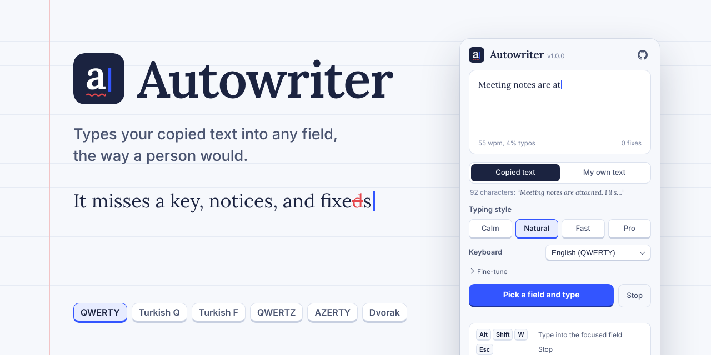
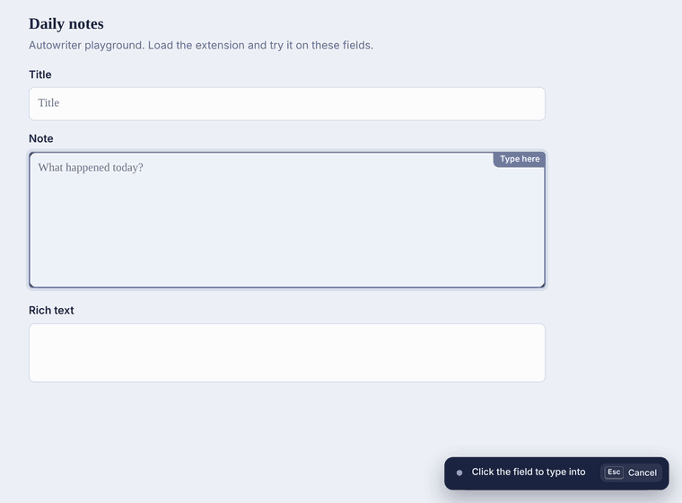
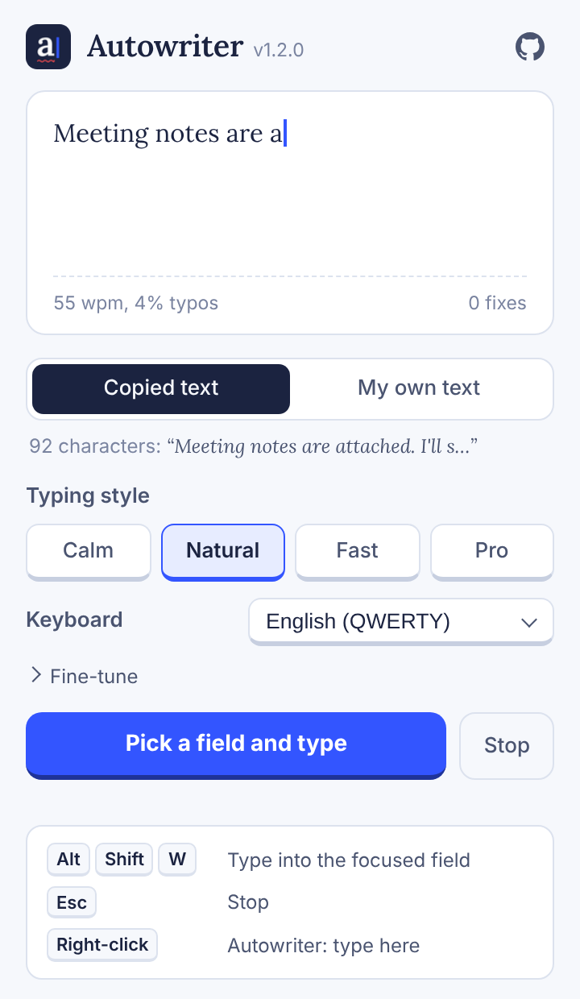
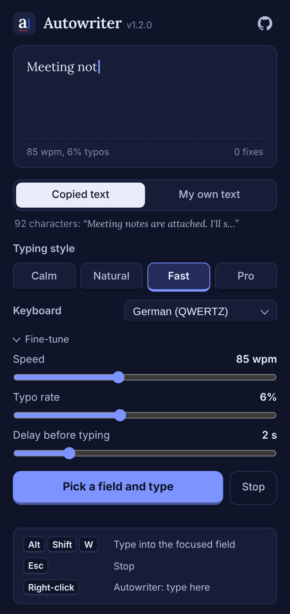
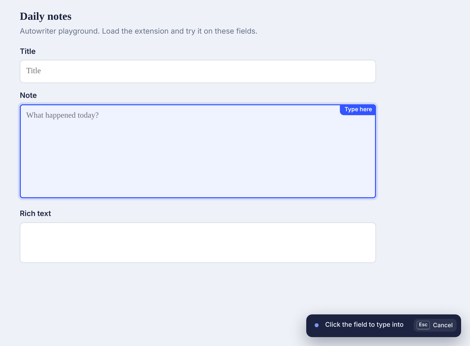
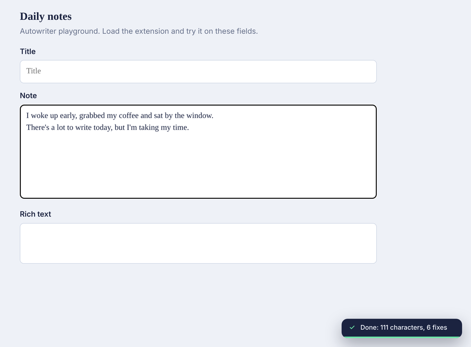
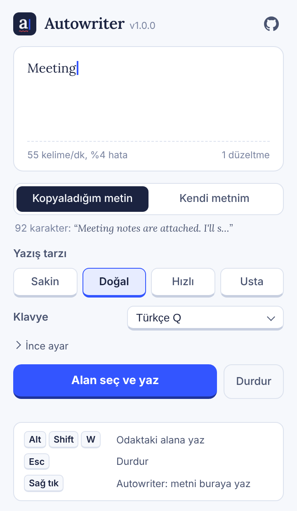

<p align="center">
  
</p>

<p align="center">
  <a href="https://github.com/Kuzuw/autowriter/actions/workflows/ci.yml"></a>
  <a href="https://github.com/Kuzuw/autowriter/releases/latest"></a>
  
  
  <a href="LICENSE"></a>
</p>

<p align="center">
  <b>Copy some text, click a field, and let Autowriter type it.</b><br>
  Key by key, at an uneven pace. Now and then it hits the wrong key, notices, and fixes it.
</p>

<p align="center">
  
</p>

---

## Contents

- [Features](#features)
- [Install](#install)
- [Usage](#usage)
- [Settings](#settings)
- [Keyboard layouts](#keyboard-layouts)
- [How it works](#how-it-works)
- [Privacy](#privacy)
- [Development](#development)
- [Türkçe](#türkçe)
- [License](#license)

## Features

- **Human rhythm.** Every keystroke takes a slightly different time. It slows down at spaces, commas and full stops, sometimes stops to "think", and its overall pace drifts as it goes.
- **Realistic typos.** Hitting a neighbouring key, doubling a letter, swapping two letters, skipping one. It notices right away or a few letters later, backspaces, and types the right thing.
- **Your keyboard.** Typos follow the layout you pick: English QWERTY, Turkish Q, Turkish F, German QWERTZ, French AZERTY, Spanish or Dvorak.
- **Works where you type.** `input`, `textarea` and `contenteditable` editors, including fields inside iframes and Shadow DOM.
- **Three ways to start.** Pick a field from the popup, press `Alt+Shift+W`, or use the right-click menu.
- **Live preview.** The popup shows how it will type with your current settings, mistakes included.
- **Stop any time.** Press `Esc` or click **Stop** on the on-page indicator.
- **English and Turkish UI.** Follows your browser language. Light and dark themes follow your system.
- **Private by design.** No network requests, no tracking. It never types into password fields.

## Install

### From a release

1. Download `autowriter-x.y.z.zip` from the [latest release](https://github.com/Kuzuw/autowriter/releases/latest) and unzip it.
2. Open `chrome://extensions`.
3. Turn on **Developer mode** (top right).
4. Click **Load unpacked** and select the unzipped folder.

### From source

```bash
git clone https://github.com/Kuzuw/autowriter
```

Then follow steps 2–4 with the `autowriter` folder.

> Edge (`edge://extensions`), Brave (`brave://extensions`) and other Chromium-based browsers work the same way.

## Usage

| How | Steps |
| --- | --- |
| **Popup** | Copy your text, click the toolbar icon, press **Pick a field and type**, then click the field. |
| **Shortcut** | Copy your text, click into a field, press `Alt+Shift+W`. Press it again to stop. |
| **Right-click** | Right-click a field and choose **Autowriter: type here**. |

You can change the shortcut at `chrome://extensions/shortcuts`.

<table>
  <tr>
    <td align="center"><br><sub>Popup</sub></td>
    <td align="center"><br><sub>Dark theme, fine-tune open</sub></td>
  </tr>
  <tr>
    <td align="center"><br><sub>Picking a field</sub></td>
    <td align="center"><br><sub>Done, with a count of characters and fixes</sub></td>
  </tr>
</table>

## Settings

| Typing style | Speed | Typo rate | Feels like |
| --- | --- | --- | --- |
| Calm | 35 wpm | 2% | Someone choosing their words |
| Natural | 55 wpm | 4% | An average typist (default) |
| Fast | 85 wpm | 6% | Quick and a bit sloppy |
| Pro | 125 wpm | 2% | A touch typist |

Under **Fine-tune**:

- **Speed:** 10–200 words per minute
- **Typo rate:** 0–15%. Set it to 0 for no mistakes at all.
- **Delay before typing:** 0–10 seconds, time to switch windows or place the cursor.
- **Text source:** the text you copied, or your own text pasted into the popup.

## Keyboard layouts

"Hit the key next to it" typos are drawn from the layout you choose, so a French user mistypes `a` as `z` and a Turkish user mistypes `ş` as `i`. On first run the layout is chosen from your browser language.

| Layout | Letter rows |
| --- | --- |
| English (QWERTY) | `qwertyuiop` `asdfghjkl` `zxcvbnm` |
| Turkish Q | `qwertyuıopğü` `asdfghjklşi` `zxcvbnmöç` |
| Turkish F | `fgğıodrnhpqw` `uieaütkmlyşx` `jövcçzsb` |
| German (QWERTZ) | `qwertzuiopü` `asdfghjklöä` `yxcvbnm` |
| French (AZERTY) | `azertyuiop` `qsdfghjklmù` `wxcvbn` |
| Spanish (QWERTY) | `qwertyuiop` `asdfghjklñ` `zxcvbnm` |
| Dvorak | `pyfgcrl` `aoeuidhtns` `qjkxbmwvz` |

Missing your layout? It's one line in [`engine.js`](engine.js). Pull requests are welcome.

## How it works

The typing logic lives in one DOM-free module, [`engine.js`](engine.js):

1. The target speed becomes an average delay per character: `60000 / (wpm × 5)` ms.
2. Each keystroke waits a random 0.55–1.6× of that. Every 15 keys the overall pace drifts a little faster or slower.
3. Spaces, punctuation and line breaks get extra pauses, with the odd 0.5–1.6 s "thinking" break.
4. When a letter is picked for a typo, one of four mistakes happens. It may type 0–3 more correct letters, pause, backspace over all of it, then type the right text.

Whatever happens along the way, the final text always matches the source exactly. [`test/engine.test.js`](test/engine.test.js) checks this across 300 random seeds, every layout, and text in several languages.

On the page, [`content.js`](content.js) types each character with the browser's `insertText` command, the same path real keyboard input takes, and falls back to the native value setter plus an `input` event. That way frameworks like React and Vue see every change.

## Privacy

Autowriter collects nothing and sends nothing anywhere. Details and the reason for each permission: [PRIVACY.md](PRIVACY.md).

## Development

```bash
npm test         # engine tests + manifest and locale checks
npm run build    # dist/autowriter-<version>.zip
```

There is no build step and no dependencies. Open [`test/playground.html`](test/playground.html) to try things by hand.

```
autowriter/
├── manifest.json        Extension manifest (MV3)
├── engine.js            Human-like typing engine and keyboard layouts
├── content.js           Field picker, typing, on-page indicator
├── background.js        Shortcut and context menu
├── popup.html/css/js    Settings and live preview
├── _locales/            English and Turkish strings
├── icons/  fonts/       Icons and the bundled Lora typeface
├── design/              Icon and banner sources
├── docs/                README images
├── scripts/             Manifest check, packaging, locale generator
└── test/                Engine tests and playground page
```

UI strings live in [`scripts/locales.py`](scripts/locales.py). Edit them there and run `python3 scripts/locales.py` to regenerate `_locales/`.

Publishing a GitHub release tagged `v` + the manifest version (for example `v1.2.0`) builds the zip and attaches it to the release. See [CONTRIBUTING.md](CONTRIBUTING.md) and the [CHANGELOG](CHANGELOG.md).

### Known limits

- Browsers don't let extensions run on `chrome://` pages or the Chrome Web Store.
- Canvas-based editors such as Google Docs handle keyboard events their own way, so results may vary.
- In single-line fields, line breaks become spaces so the form isn't submitted by accident.
- On tabs opened before installing, reload the page once for the shortcut and right-click menu. Starting from the popup works without reloading.

### Responsible use

Autowriter is meant for demos, screen recordings, presentations, testing, and typing out your own text. Using it where exams, coursework or workplace rules forbid it is your responsibility.

## Türkçe

<details>
<summary>Türkçe açıklama</summary>

<p align="center"></p>

**Autowriter**, kopyaladığın metni seçtiğin alana insan gibi yazan bir Chrome eklentisidir. Değişken hızla yazar, noktalamada duraksar; arada yanlış tuşa basar, fark eder ve düzeltir.

- **Başlatma:** Popup'tan **Alan seç ve yaz**, `Alt+Shift+W` kısayolu ya da yazı alanında sağ tık → **Autowriter: metni buraya yaz**. `Esc` ile durur.
- **Yazış tarzları:** Sakin, Doğal, Hızlı, Usta. İnce ayardan hız (10–200 kelime/dk), hata oranı (%0–15) ve başlama gecikmesi ayarlanır.
- **Klavye düzeni:** Türkçe Q, Türkçe F, İngilizce QWERTY, Almanca QWERTZ, Fransızca AZERTY, İspanyolca ve Dvorak. Yazım hataları seçtiğin düzene göre yapılır.
- **Dil:** Tarayıcın Türkçeyse arayüz Türkçe açılır.
- **Gizlilik:** Ağ isteği yok, veri toplama yok, şifre alanlarına yazmaz.

**Kurulum:** [Son sürümdeki](https://github.com/Kuzuw/autowriter/releases/latest) zip'i indirip çıkar, `chrome://extensions` sayfasında **Geliştirici modu**'nu aç, **Paketlenmemiş öğe yükle** ile klasörü seç.

</details>

## License

[MIT](LICENSE) © 2026 Kuzuw. The bundled [Lora](https://github.com/cyrealtype/Lora-Cyrillic) typeface is licensed under the SIL Open Font License 1.1 ([fonts/OFL.txt](fonts/OFL.txt)).

---

<sub>Autowriter was built with help from Claude, Anthropic's AI assistant.</sub>
